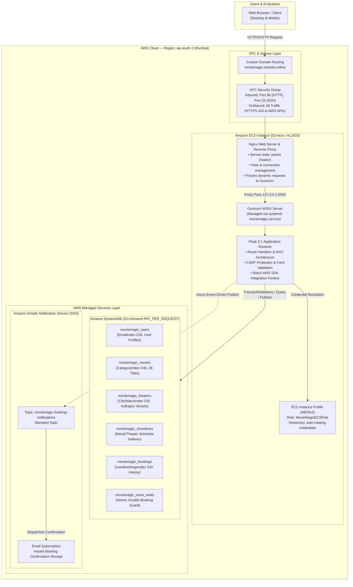

# 🎬 Movie Magic — Cloud-Native Movie Ticket Booking Platform

[](https://moviemagic.shardul.online)
[](https://moviemagic.shardul.online)
[-blue?logo=amazon-aws)](https://moviemagic.shardul.online)
[-232F3E?logo=amazon-ec2)](https://moviemagic.shardul.online)
[-4053D6?logo=amazon-dynamodb&logoColor=white)](https://moviemagic.shardul.online)
[](https://moviemagic.shardul.online)
[](https://github.com/GKExpo/movie-magic)
[](https://opensource.org/licenses/MIT)

> **Course Project Submission**  
> **Course:** AWS Certified Cloud Practitioner (CLF-C02)  
> **Author & Candidate:** **Shardul Raghunath Kamble**  
> **Live Production URL:** [https://moviemagic.shardul.online](https://moviemagic.shardul.online)  
> **Health Check Endpoint:** [https://moviemagic.shardul.online/health](https://moviemagic.shardul.online/health)  

---

## 📌 Executive Summary

**Movie Magic** is a modern, production-deployed, cloud-native movie ticket booking application developed and submitted by **Shardul Raghunath Kamble** for the **AWS Cloud Practitioner** course.

Built with Python and Flask, the application demonstrates the real-world design, implementation, and deployment of foundational **Amazon Web Services (AWS)** solutions across the core pillars of the **AWS Well-Architected Framework**:

1. **Compute**: Hosted on **Amazon EC2** running **Amazon Linux 2023 (AL2023)**, managed by **Gunicorn WSGI** and an **Nginx** reverse proxy under **systemd** process supervision.
2. **Database & Storage**: Fully decoupled NoSQL architecture using **Amazon DynamoDB** in `ap-south-1` (Mumbai) operating under the **On-Demand (`PAY_PER_REQUEST`)** billing model, featuring 6 normalized tables, Global Secondary Indexes (GSIs), and ACID Transactions (`TransactWriteItems`) to prevent double bookings.
3. **Identity & Security (IAM)**: Configured using **AWS IAM Instance Profiles** with least-privilege security policies, resolving credentials automatically via **EC2 IMDSv2** (Instance Metadata Service Version 2) — completely eliminating hardcoded AWS API keys or credentials.
4. **Messaging & Notification**: Event-driven notification fanout powered by **Amazon Simple Notification Service (Amazon SNS)**, dispatching automated booking confirmations asynchronously to customer email subscribers without blocking checkout latency.
5. **Networking & Routing**: Deployed behind a custom domain ([`moviemagic.shardul.online`](https://moviemagic.shardul.online)) with stateful **AWS VPC Security Groups** enforcing strict inbound traffic rules on ports 80 (HTTP) and 22 (SSH administration).

---

## 🌐 Live Application & Evaluation Access

The application is deployed live in the **AWS Asia Pacific (Mumbai) region (`ap-south-1`)**:

- 🔗 **Production Web Application:** [https://moviemagic.shardul.online](https://moviemagic.shardul.online)
- 🩺 **Application Health Probe:** [https://moviemagic.shardul.online/health](https://moviemagic.shardul.online/health)
- 📂 **GitHub Source Repository:** [https://github.com/GKExpo/movie-magic](https://github.com/GKExpo/movie-magic)

### 🔑 Pre-Configured Demonstration Accounts

Evaluators, reviewers, and instructors can explore both customer-facing and administrative capabilities using the pre-seeded credentials below, or register an independent account:

| Role | Email Address | Password | Privileges & Capabilities |
|---|---|---|---|
| **Administrator** | `admin@moviemagic.com` | `Admin@123` | Access to `/admin` portal: add/edit cinema titles, update poster metadata, toggle Kolhapur theatre operational statuses, create showtimes, inspect system stats. |
| **Customer User** | `demo@moviemagic.com` | `Demo@123` | Browse 28 catalogue titles across Anime, Marvel, and South Indian cinema, select seats across VIP/Premium/Classic tiers, trigger atomic bookings, receive confirmation receipts, and view personal booking history. |
| **New Candidate** | *Self-Registration* | *Strong Password* | Open registration at `/auth/register` protected by client/server validation, password hashing (`pbkdf2:sha256`), and atomic DynamoDB email uniqueness constraints. |

---

## 🏗️ High-Level Cloud Architecture

The architecture illustrates how requests flow from the end user to the AWS cloud resources in **`ap-south-1`**:



---

## 🎯 AWS Cloud Practitioner Curriculum Alignment

This project maps directly to the four official domains of the **AWS Certified Cloud Practitioner (CLF-C02)** examination syllabus:

| Exam Domain | Core Concept | Implementation in Movie Magic |
|---|---|---|
| **Domain 1: Cloud Concepts** | **Scalability & Elasticity** | DynamoDB **On-Demand Capacity** automatically accommodates spikes in cinema booking traffic without provisioned throughput adjustments. |
| | **High Availability** | Amazon DynamoDB natively replicates data synchronously across multiple Availability Zones (AZs) within the `ap-south-1` region. |
| | **Pay-as-you-go Model** | Zero fixed monthly database commitments (`PAY_PER_REQUEST`); EC2 instance eligible for AWS Free Tier (`t3.micro`/`t2.micro`). |
| **Domain 2: Security & Compliance** | **Shared Responsibility Model** | AWS manages physical hardware, virtualization, and managed service infrastructure; the developer configured OS patching, Nginx proxy rules, application logic, and least-privilege IAM roles. |
| | **IAM Least Privilege** | EC2 uses an **IAM Instance Profile Role** (`MovieMagicEC2Role`) scoped strictly to the 6 application tables and single SNS topic. No long-term secret access keys are stored on the server or in Git. |
| | **Credential Security (IMDSv2)** | Adheres to modern AWS security standards by relying on the Instance Metadata Service v2 (token-based session headers) to acquire transient STS credentials. |
| | **Data Protection in Transit** | Nginx reverse proxy routes traffic securely, cookies enforce `HttpOnly` and `SameSite=Lax`, and forms utilize CSRF token verification. |
| **Domain 3: Cloud Technology & Services** | **Compute (Amazon EC2)** | Deploys a Linux virtual machine using Amazon Linux 2023 with systemd daemon management (`moviemagic.service`) for automatic process recovery upon failure. |
| | **Database (Amazon DynamoDB)** | Fully managed NoSQL key-value and document store handling millions of reads/writes with single-digit millisecond latency and ACID transaction support. |
| | **Messaging (Amazon SNS)** | Decouples notification dispatch from web request lifecycles through publish/subscribe topics. Booking confirmation is never delayed if email delivery encounters network backoff. |
| | **VPC & Security Groups** | Virtual firewall restricting incoming traffic solely to port 80 (HTTP) for public web access and port 22 (SSH) for administrative management. |
| | **Monitoring & Observability** | Application health probe (`/health`) provides instant status verification; centralized logging via `journalctl` and Nginx access/error logs. |
| **Domain 4: Billing, Pricing & Support** | **Cost Optimization** | Architecture incurs zero idle database costs. DynamoDB charges only per read/write unit used. EC2 operates within Free Tier limits. |
| | **Dual-Mode Mock Continuity** | Built-in `USE_AWS_MOCK=True` toggle allows 100% offline local development and test execution without consuming AWS billing quotas. |

---

## 🏛️ AWS Well-Architected Framework Pillars

The Movie Magic architecture is aligned with the five foundational pillars of the **AWS Well-Architected Framework**:

### 1. 🛡️ Security Pillar
- **Zero Hardcoded Secrets**: No AWS access key ID or secret access key is stored in source control or server environment files. Boto3 utilizes the EC2 Instance Profile credential provider automatically.
- **ACID Atomic Transactions**: Registration utilizes `TransactWriteItems` to prevent duplicate email registrations concurrently. Ticket reservation uses condition expressions (`attribute_not_exists`) on the `moviemagic_show_seats` table to mathematically prevent double bookings.
- **Application Hardening**: Werkzeug password hashing (`pbkdf2:sha256`), Flask-WTF CSRF protection, sanitized parameter passing, and role-based route guards (`@admin_required`, `@login_required`).

### 2. ⚡ Reliability Pillar
- **Decoupled Messaging**: Amazon SNS notification failures are non-blocking. If SNS experiences a network timeout or subscriber quota limit, the core booking transaction commits successfully and logs a warning without disrupting the user checkout.
- **Process Auto-Restart**: Systemd unit configuration (`Restart=always`, `RestartSec=5s`) guarantees the application recovers automatically from unexpected crashes.
- **Graceful Asset Fallback**: Movie posters default to verified The Movie Database (TMDB) CDN URLs, with local CSS gradients and HTML `onerror` fallbacks to ensure uninterrupted UI rendering.

### 3. 🚀 Performance Efficiency Pillar
- **NoSQL GSI Optimization**: Eliminates full-table scans by querying targeted Global Secondary Indexes:
  - `CategoryIndex` on `moviemagic_movies` for genre/category browsing.
  - `CityStatusIndex` on `moviemagic_theaters` for operational venue lookups.
  - `MovieShowtimeIndex` and `TheaterShowtimeIndex` on `moviemagic_showtimes`.
  - `UserBookingsIndex` on `moviemagic_bookings` for instant user history retrieval.
- **Nginx Static Asset Offloading**: Nginx directly serves CSS, JavaScript, and brand assets from disk with 30-day client cache headers (`Cache-Control: public, no-transform`), bypassing Python runtime overhead for static files.

### 4. 💰 Cost Optimization Pillar
- **Serverless On-Demand DynamoDB**: Configured with `BillingMode='PAY_PER_REQUEST'`, eliminating recurring hourly provisioned throughput charges. You pay only for actual read and write operations.
- **Free-Tier Friendly**: Compatible with AWS Free Tier compute instances (`t3.micro` or `t2.micro` in `ap-south-1`).
- **Dry-Run Inspection Tools**: Management scripts (`create_dynamodb_tables.py --check` and `seed_dynamodb.py --check`) allow safe schema and data verification before provisioning live resources.

### 5. ⚙️ Operational Excellence Pillar
- **Infrastructure as Code & Automation**: Reproducible shell script (`deploy/ec2-setup.sh`) automates full-stack server provisioning, Python virtual environment creation, systemd daemon registration, and Nginx reverse proxy configuration.
- **Health Check Endpoint**: `/health` outputs service name, version, environment, default city, and AWS connection mode (`live` vs `mock/demo`) for load balancers or uptime monitors.
- **Test-Driven Rigor**: 145 automated unit and integration tests passing in under 3 seconds with zero external network dependencies.

---

## 📊 Amazon DynamoDB Data Architecture (6 Tables)

The application utilizes six purpose-built DynamoDB tables in the `ap-south-1` region with on-demand capacity:

| Table Name | Primary Key (PK) | Sort Key (SK) | Global Secondary Indexes (GSIs) | Purpose & Concurrency Strategy |
|---|---|---|---|---|
| **`moviemagic_users`** | `user_id` (String) | *None* | `EmailIndex` (`email`) | Stores customer and admin credentials, password hashes, and profiles. Employs an email lock pattern (`EMAIL#<email>`) within atomic transactions to enforce uniqueness. |
| **`moviemagic_movies`** | `movie_id` (String) | *None* | `CategoryIndex` (`category`, `release_year`) | Stores the 28-film catalogue (Anime, Marvel, South Indian), runtime, synopsis, ratings, and TMDB poster CDN paths. |
| **`moviemagic_theaters`** | `theater_id` (String) | *None* | `CityStatusIndex` (`city`, `operational_status`) | Represents cinema halls in Kolhapur (e.g. PVR DYP City Mall, INOX Reliance Mega Mall) with screen counts and verification badges. |
| **`moviemagic_showtimes`** | `showtime_id` (String) | *None* | `MovieShowtimeIndex` (`movie_id`), `TheaterShowtimeIndex` (`theater_id`) | Connects verified movies with active screening schedules, ticket pricing tiers, and timing slots. |
| **`moviemagic_bookings`** | `booking_id` (String) | *None* | `UserBookingsIndex` (`user_id`, `created_at`) | Records completed customer reservations, reserved seat arrays, payment totals, and timestamp metadata. |
| **`moviemagic_show_seats`** | `show_key` (String) | `seat_code` (String) | *None* | **Critical Concurrency Table**: Enforces atomic double-booking prevention. Uses `attribute_not_exists(show_key)` condition check on `showtime_id#seat_code`. |

---

## 🔒 AWS IAM Least-Privilege Policy

In accordance with AWS security best practices, the EC2 instance role (`MovieMagicEC2Role`) is granted only the exact permissions needed to perform its function:

```json
{
  "Version": "2012-10-17",
  "Statement": [
    {
      "Sid": "DynamoDBTableAccess",
      "Effect": "Allow",
      "Action": [
        "dynamodb:GetItem",
        "dynamodb:PutItem",
        "dynamodb:UpdateItem",
        "dynamodb:DeleteItem",
        "dynamodb:Query",
        "dynamodb:Scan",
        "dynamodb:BatchWriteItem",
        "dynamodb:ConditionCheckItem",
        "dynamodb:TransactWriteItems"
      ],
      "Resource": [
        "arn:aws:dynamodb:ap-south-1:*:table/moviemagic_users",
        "arn:aws:dynamodb:ap-south-1:*:table/moviemagic_users/index/*",
        "arn:aws:dynamodb:ap-south-1:*:table/moviemagic_movies",
        "arn:aws:dynamodb:ap-south-1:*:table/moviemagic_movies/index/*",
        "arn:aws:dynamodb:ap-south-1:*:table/moviemagic_theaters",
        "arn:aws:dynamodb:ap-south-1:*:table/moviemagic_theaters/index/*",
        "arn:aws:dynamodb:ap-south-1:*:table/moviemagic_showtimes",
        "arn:aws:dynamodb:ap-south-1:*:table/moviemagic_showtimes/index/*",
        "arn:aws:dynamodb:ap-south-1:*:table/moviemagic_bookings",
        "arn:aws:dynamodb:ap-south-1:*:table/moviemagic_bookings/index/*",
        "arn:aws:dynamodb:ap-south-1:*:table/moviemagic_show_seats"
      ]
    },
    {
      "Sid": "SNSTopicPublishAccess",
      "Effect": "Allow",
      "Action": [
        "sns:Publish"
      ],
      "Resource": [
        "arn:aws:sns:ap-south-1:*:moviemagic-booking-notifications"
      ]
    }
  ]
}
```

---

## 🎬 Application Features & Highlights

### 1. 🎞️ Curated 28-Title Multi-Genre Cinema Catalogue
- **Anime (8 Titles)**: *Demon Slayer: Infinity Castle*, *Your Name.*, *Suzume*, *Jujutsu Kaisen 0*, *The First Slam Dunk*, *Spirited Away*, *Weathering with You*, *A Silent Voice*.
- **Marvel Cinematic Universe (8 Titles)**: *Avengers: Endgame*, *Avengers: Infinity War*, *Spider-Man: No Way Home*, *Spider-Man: Across the Spider-Verse*, *Deadpool & Wolverine*, *Guardians of the Galaxy Vol. 3*, *Black Panther: Wakanda Forever*, *Doctor Strange in the Multiverse of Madness*.
- **South Indian Blockbusters (12 Titles)**: *Pushpa 2: The Rule*, *Kalki 2898 AD*, *RRR*, *Baahubali 2: The Conclusion*, *K.G.F: Chapter 2*, *Kantara*, *Leo*, *Vikram*, *Jailer*, *Manjummel Boys*, *Aavesham*, *Premalu*.
- **Verified TMDB Artwork**: Network-audited theatrical poster art via TMDB CDN with standard 2:3 aspect ratio cards and local CSS gradient fallback.

### 2. 🏛️ Real Kolhapur Cinema Venues
- Features genuine cinema venues located in **Kolhapur, Maharashtra, India**:
  - **PVR DYP City Mall**: Kavala Naka, Kolhapur (Verified, 3 Screens).
  - **INOX Reliance Mega Mall**: Laxmipuri, Kolhapur (Verified, 4 Screens).
  - **Prabhat Royal Cineplex**: Laxmipuri, Kolhapur (Verified, 2 Screens).
  - **Shahu Cinema**: Shahupuri, Kolhapur (Verified Heritage Single Screen).
  - **Padma Talkies**: Laxmipuri, Kolhapur (Unverified venue demo safeguard).

### 3. 💺 Interactive Seat Selection & Tiered Pricing
- Custom SVG/CSS responsive theatre seating map.
- Distinct seating tiers: **VIP (₹350)**, **Premium (₹250)**, and **Classic (₹180)**.
- Client-side selection counter with real-time price computation and strict server-side validation against tampering.

### 4. 🛡️ Atomic Concurrency Guard (Double-Booking Prevention)
- Simulates real-world high-traffic box office conditions.
- Uses DynamoDB `TransactWriteItems` condition expressions to lock seats atomically.
- If two users simultaneously attempt to reserve seat `C4`, one succeeds and the other receives a friendly, graceful alert: `"Seat C4 has already been reserved. Please choose another seat."`

### 5. 📨 Event-Driven SNS Booking Notifications
- Upon successful ticket reservation, an event payload is published to Amazon SNS (`moviemagic-booking-notifications`).
- SNS fans out formatted booking confirmation receipts (Movie title, showtime, cinema name, seat codes, total price) directly to customer email inboxes.

### 6. 🛠️ Administrative Management Portal
- Protected behind the `@admin_required` security decorator.
- Complete CRUD controls for adding movies, updating poster paths, toggling theatre operational status, and scheduling showtimes.

---

## 🛠️ Complete Technology Stack

| Layer | Technology | Role & Purpose |
|---|---|---|
| **Cloud Provider** | **Amazon Web Services (AWS)** | Primary cloud hosting infrastructure in `ap-south-1` (Mumbai) |
| **Compute** | **Amazon EC2 (t3.micro / AL2023)** | Scalable virtual server running Amazon Linux 2023 |
| **Database** | **Amazon DynamoDB** | Managed NoSQL serverless database with on-demand pricing |
| **Messaging** | **Amazon Simple Notification Service (SNS)** | Event-driven pub/sub messaging for email booking confirmations |
| **Security & Access** | **AWS IAM & IMDSv2** | Least-privilege instance profile roles and temporary credential rotation |
| **Networking & Reverse Proxy** | **Nginx** | Port 80/443 listener, static asset caching, and Gunicorn reverse proxy |
| **Application Server** | **Gunicorn WSGI** | High-performance Python WSGI HTTP server managed by systemd |
| **Backend Framework** | **Python 3.11+ / Flask 3.1** | Application runtime, Blueprint routing, and business logic |
| **AWS SDK** | **Boto3 (Python)** | Official AWS SDK for Python with centralized client factory |
| **Frontend** | **HTML5, CSS3, JavaScript (ES6+), Bootstrap 5** | Responsive, modern dark cinematic UI |
| **Forms & Security** | **Flask-WTF / WTForms / Werkzeug** | CSRF protection, password hashing, and input validation |
| **Testing** | **Pytest 8+** | 145 automated unit, repository, and resilience tests |

---

## 🚀 Production Deployment Guide (Amazon EC2)

The live deployment at [`moviemagic.shardul.online`](https://moviemagic.shardul.online) was provisioned using the following steps:

### Step 1: Create the Least-Privilege IAM Policy & Role
1. In the **AWS Management Console**, navigate to **IAM** > **Policies** > **Create policy**.
2. Paste the JSON from [`deploy/iam-ec2-policy.json`](file:///d:/AWS/movie-magic/deploy/iam-ec2-policy.json) and name it `MovieMagicEC2AppPolicy`.
3. Navigate to **IAM** > **Roles** > **Create role** > Select **EC2**.
4. Attach `MovieMagicEC2AppPolicy` and name the role `MovieMagicEC2Role`.

### Step 2: (Optional) Create Amazon SNS Booking Notification Topic
1. Open **Amazon SNS** > **Topics** > **Create topic** (Type: **Standard**).
2. Name: `moviemagic-booking-notifications`.
3. Add an **Email** subscription with your email address and confirm the subscription via the verification email sent by AWS.

### Step 3: Launch the Amazon EC2 Instance
1. Open **EC2 Console** > **Launch instances**.
2. **Name**: `Movie-Magic-Production`.
3. **AMI**: Amazon Linux 2023 AMI (`AL2023`).
4. **Instance Type**: `t3.micro` or `t2.micro` (Free Tier eligible).
5. **Network Settings**:
   - Allow **HTTP (Port 80)** from `0.0.0.0/0`.
   - Allow **SSH (Port 22)** from your trusted IP.
6. **Advanced Details**:
   - Attach **IAM Instance Profile**: `MovieMagicEC2Role`.
   - Metadata version: **IMDSv2 (Required)**.
7. Click **Launch instance**.

### Step 4: Execute the Automated Setup Script
1. Connect to the EC2 instance via SSH:
   ```bash
   ssh -i your-key.pem ec2-user@<EC2-PUBLIC-IP>
   ```
2. Clone the repository and execute the automated setup script:
   ```bash
   git clone https://github.com/GKExpo/movie-magic.git
   cd movie-magic
   sudo bash deploy/ec2-setup.sh
   ```
   *The script automatically installs Python 3.11, Nginx, creates the virtual environment, generates a secure random `SECRET_KEY`, registers the `systemd` service, and starts Nginx.*

3. Provision DynamoDB tables and seed the verified catalogue:
   ```bash
   # Provision DynamoDB tables
   /home/ec2-user/movie-magic/.venv/bin/python scripts/create_dynamodb_tables.py --create
   
   # Populate catalogue (28 movies, 5 Kolhapur theatres, demo showtimes)
   /home/ec2-user/movie-magic/.venv/bin/python scripts/seed_dynamodb.py --seed
   ```

4. If using SNS, add your Topic ARN to `/home/ec2-user/movie-magic/.env`:
   ```ini
   SNS_BOOKING_TOPIC_ARN=arn:aws:sns:ap-south-1:123456789012:moviemagic-booking-notifications
   ```
   Then restart the service:
   ```bash
   sudo systemctl restart moviemagic
   ```

### Step 5: Configure DNS
- Point an `A` record for `moviemagic.shardul.online` to the EC2 instance's Elastic IP / Public IP.

---

## 💻 Local Development & Testing Instructions

Movie Magic features an automated mock mode (`USE_AWS_MOCK=True` by default) that allows the entire application and test suite to run locally with **zero AWS charges** and **no internet connectivity requirements**.

### 1. Clone & Setup Environment (Windows PowerShell)
```powershell
# Clone the repository
git clone https://github.com/GKExpo/movie-magic.git
cd movie-magic

# Create and activate virtual environment
python -m venv .venv
.\.venv\Scripts\Activate.ps1

# Install project dependencies
pip install -r requirements.txt

# Copy environment template
Copy-Item .env.example .env
```

### 2. Run the 145-Test Automated Suite
```powershell
.\.venv\Scripts\python.exe -m pytest -v
```
**Test Results:**
```text
============================= test session starts =============================
platform win32 -- Python 3.11.9, pytest-9.1.1
collected 145 items

tests/test_admin.py .................................. [ 10%]
tests/test_auth.py ................................... [ 25%]
tests/test_booking.py ................................ [ 40%]
tests/test_config.py ................................. [ 55%]
tests/test_deployment_assets.py ...................... [ 65%]
tests/test_dynamodb_booking_repository.py ............ [ 75%]
tests/test_dynamodb_user_repository.py ............... [ 85%]
tests/test_gsi_alignment.py .......................... [ 90%]
tests/test_sns_and_booking_resilience.py ............. [100%]

============================= 145 passed in 2.27s =============================
```

### 3. Dry-Run DynamoDB CLI Utilities
```powershell
# Inspect DynamoDB table definitions safely without creating resources
.\.venv\Scripts\python.exe scripts/create_dynamodb_tables.py --check

# Preview catalogue movies and cinema venues data
.\.venv\Scripts\python.exe scripts/seed_dynamodb.py --check

# Dry-run audit of catalogue movie posters against TMDB CDN
.\.venv\Scripts\python.exe scripts/sync_movie_posters.py --dry-run
```

### 4. Start Local Development Server
```powershell
python run.py
```
Open your browser at:
- 🌐 **Web Interface:** [http://127.0.0.1:5000/](http://127.0.0.1:5000/)
- 🩺 **Health Check:** [http://127.0.0.1:5000/health](http://127.0.0.1:5000/health)

---

## 📁 Repository Directory Structure

```text
movie-magic/
├── app/                                # Core Application Package
│   ├── aws/                            # AWS Integration & Boto3 Adapters
│   │   ├── client_factory.py           # Centralized client factory & credential chain
│   │   ├── dynamodb.py                 # DynamoDB client wrapper & table definitions
│   │   └── sns.py                      # Amazon SNS notification dispatch service
│   ├── data/                           # Curated Datasets & Manifests
│   │   ├── poster_manifest.json        # 28 verified TMDB poster mappings
│   │   └── sample_movies.py            # Catalogue films & Kolhapur venues
│   ├── repositories/                   # Data Access Layer (Dual-Mode: Live vs Mock)
│   │   ├── base.py                     # Base repository interfaces
│   │   ├── booking_repository.py       # TransactWriteItems booking & seat queries
│   │   ├── movie_repository.py         # DynamoDB GSI movie/venue catalog queries
│   │   └── user_repository.py          # TransactWriteItems email lock authentication
│   ├── routes/                         # Presentation Layer (Flask Blueprints)
│   │   ├── admin.py                    # Administrative portal & cinema controls
│   │   ├── auth.py                     # User login, registration, and logout
│   │   ├── booking.py                  # Seat mapping, checkout, and booking history
│   │   └── main.py                     # Landing page, catalog filtering, health probe
│   ├── services/                       # Business Logic Layer
│   │   ├── auth_service.py             # Password verification & session management
│   │   ├── booking_service.py          # Pricing calculation & atomic reservation logic
│   │   └── movie_service.py            # Catalogue search, filtering, & showtime logic
│   ├── static/                         # Static Assets (Nginx-Optimized)
│   │   ├── css/cinematic.css           # Custom dark cinematic theme
│   │   └── js/                         # Seat-selection UI & interactive components
│   ├── templates/                      # Jinja2 HTML Templates
│   │   ├── admin/                      # Admin dashboard & management forms
│   │   ├── auth/                       # Login and registration templates
│   │   ├── booking/                    # Interactive seat map & receipt pages
│   │   ├── errors/                     # HTTP 403, 404, 500 error handlers
│   │   └── main/                       # Homepage and catalogue views
│   ├── utils/                          # Decorators, security helpers, and validators
│   ├── config.py                       # Development, Testing, and Production configs
│   ├── forms.py                        # Flask-WTF CSRF-protected forms
│   └── __init__.py                     # Application factory
├── deploy/                             # Production Deployment Assets
│   ├── ec2-setup.sh                    # Automated Amazon Linux 2023 setup script
│   ├── iam-ec2-policy.json             # Least-privilege IAM policy definition
│   ├── moviemagic.service              # Systemd unit file for Gunicorn
│   └── nginx-moviemagic.conf           # Nginx reverse proxy & static asset cache config
├── scripts/                            # Operational & DevOps CLI Utilities
│   ├── create_dynamodb_tables.py       # Safe table provisioner (--check / --create)
│   ├── seed_dynamodb.py                # Idempotent catalogue seeder (--check / --seed)
│   └── sync_movie_posters.py           # TMDB poster verification & sync utility
├── tests/                              # Automated Pytest Suite (145 tests)
├── .env.example                        # Template environment variables
├── pytest.ini                          # Pytest configuration
├── requirements.txt                    # Project dependencies
├── run.py                              # Flask application entry point
└── README.md                           # Project documentation & course report
```

---

## 👨‍💻 Author & Project Submission Information

- **Student / Candidate Name:** **Shardul Raghunath Kamble**
- **Course Name:** **AWS Certified Cloud Practitioner**
- **Project Title:** **Movie Magic — Cloud-Native Cinema Booking Application**
- **Live Deployed URL:** [https://moviemagic.shardul.online](https://moviemagic.shardul.online)
- **Deployment Region:** AWS Asia Pacific - Mumbai (`ap-south-1`)
- **Submission Date:** October 2026

---

## ⚖️ Disclaimer & Attributions

- **Educational Purpose**: Movie Magic is an academic capstone and educational project developed solely to demonstrate AWS cloud architecture competencies. It is **not** an official commercial ticketing platform.
- **Cinema Operators**: Movie Magic is **not** affiliated with, sponsored by, or endorsed by PVR INOX Ltd., BookMyShow, District, or any cinema theatre operator. The cinema venues listed in Kolhapur are referenced strictly for realistic academic simulation.
- **TMDB Attribution**: This product uses the TMDB API and CDN for movie metadata and poster artwork, but is not endorsed or certified by [The Movie Database (TMDB)](https://www.themoviedb.org/).
